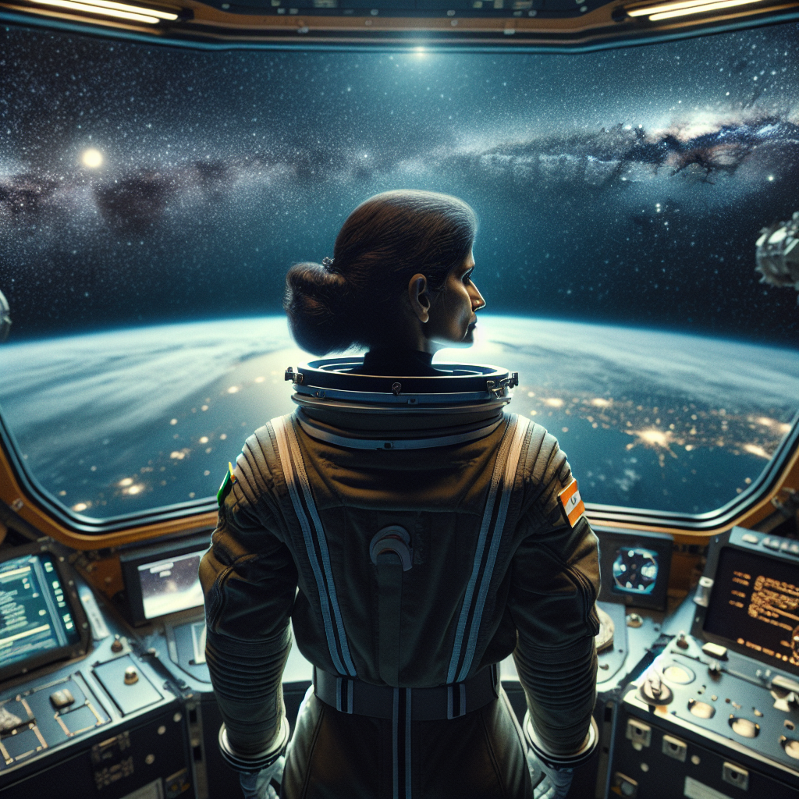
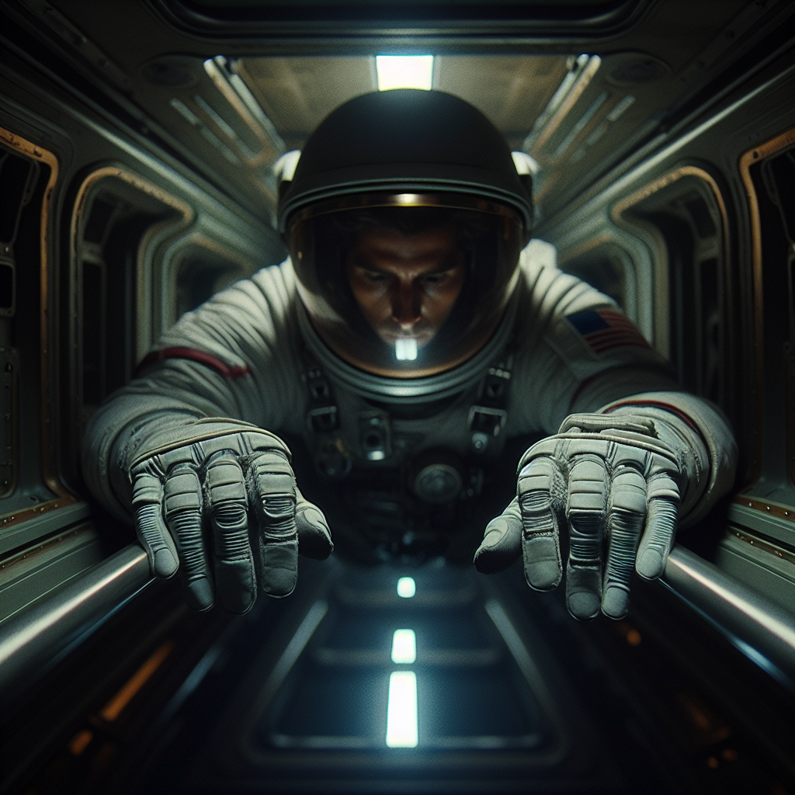

# Chapters 1–4 — Sudowrite manuscript

Echoes of the Void · Illustrated manuscript · 2023

Four unfinished chapters from the Sudowrite material, dated 2023 by the author, with the two supplied illustrations in their original positions. Scene-beat markers and draft inconsistencies are retained. Chapter 1 shares its prose with the revised draft in the January 2024 review archive. Chapters 2–4 are alternative versions; neither sequence is presented as a finished edition.

## Chapter 1

### 1 - 2

Observation deck illustration · Sudowrite working material, 2023.

Captain Priya Singh stood at the observation deck, her eyes fixed on the stars that lay beyond the spacecraft's window. The vast expanse of space stretched out before her, a silent reminder of the enormity of their mission. As she gazed at the celestial bodies that had inspired her since childhood, Priya felt the weight of responsibility settle upon her shoulders like an invisible cloak. This mission was more than just fulfilling a lifelong dream; it was her chance to honour the memory of her late mentor, Dr. Avinash Rao, who had believed in her when no one else would.

"Captain," a voice came from behind her, breaking her reverie. Turning, she saw Elena Kozlova, the mission's communications officer, holding a data pad. "I have the final pre-launch checklist for your approval."

"Thank you, Elena," Priya said as she took the pad, her tone firm but warm. She quickly scanned through the document, her focus shifting seamlessly from introspection to action. With each item checked off the list, Priya felt her confidence grow, but it was tempered by the knowledge that the lives of her crew depended on her leadership.

"Everything looks in order," Priya said, handing the pad back to Elena. "I appreciate your diligence. Let's make sure everyone is prepared for launch."

"Understood, Captain." Elena nodded and left the observation deck, her expression a mix of respect and determination.

In the control room, Dr. Leo Hernandez furrowed his brow as he assessed the propulsion system's readouts. A minor anomaly jeopardized the delicate balance of power distribution in the spacecraft. Fingers flew over the console, recalibrating with precision as he addressed the issue.

"Dr. Hernandez, what's the status?" Priya asked, entering the control room. Her voice conveyed authority, but also a hint of empathy, understanding the pressure he was under.

"Almost there, Captain," Leo replied, his tone measured and logical. "I've identified a minor hiccup in the propulsion system, but it should be resolved shortly."

As Leo continued to work, his thoughts drifted towards his own motivations for joining the mission. The challenges he had faced throughout his career had honed his skills and determination, and he took pride in his ability to solve problems others deemed impossible. But that pride also fueled a deep-rooted scepticism towards anything that threatened the mission's success. Little did he know how that scepticism would be tested in the days ahead.

"Got it," Leo announced, a hint of satisfaction in his voice. "Propulsion system is now operating at optimal efficiency."

"Excellent work, Dr. Hernandez," Priya commended, her eyes meeting his with gratitude. "Your expertise is invaluable to this mission."

"Thank you, Captain," he responded, acknowledging her praise with a nod, though his ever-practical nature kept him grounded. Together, they prepared for the launch, knowing that their journey into the unknown had only just begun.

### 3 - 4

The metallic hum of the spacecraft's machinery echoed through the narrow corridors as Alex Mendoza carefully inspected the life support systems. Their hands moved with practiced precision, each movement reflecting their meticulous nature and attention to detail. As they tightened a valve, a memory surfaced—a past failure that had nearly cost them everything. They paused, fingers gripping the wrench tighter, feeling the familiar weight of their past pressing down on their chest.

"Everything alright, Alex?" Elena Kozlova's voice broke through the quiet tension, her Russian accent soft but unmistakable.

"Uh, yes," Alex replied, forcing a smile. "Just double-checking everything before we launch."

"Good," Elena said, her eyes lingering on Alex for a moment longer than necessary. She turned her attention back to her console, ensuring the communication systems were operational. As she worked, an internal monologue played in her head, hinting at her deeper connection to the mission's undisclosed aspects. It was vital that she maintained her composure, her complex loyalty torn between her empathy towards Alex and her hidden secret.

"Alex," Elena began, hesitating briefly as she recalled a moment when she too felt out of depth. "You know, I understand what it's like to have something to prove. To feel like you're always carrying a burden on your shoulders."

"Really?" Alex asked, raising an eyebrow. "I didn't think someone like you would ever feel that way."

Elena smiled, but there was sadness behind her eyes. "We all have our demons, Alex. Just remember, it's okay to lean on others when you need to."

"Thanks, Elena," Alex said quietly, appreciating the sentiment but unsure if they could ever truly reveal the extent of their struggle.

As the final preparations continued throughout the ship, Alex couldn't shake the sense that their personal demons wouldn't remain buried for long. The pressure of the mission, the isolation of space—these factors threatened to unravel the fragile threads holding their mental health together. But for now, they had a job to do, and they would face their demons head-on, determined to prove their worth in the vast emptiness of the cosmos.

### 5 - 6

Dr. Yuto Takahashi's gaze was firmly fixed on the panoramic window, his eyes tracing constellations as they danced across the cosmos. The soft hum of the spacecraft reverberated throughout the room, providing a soothing backdrop to his thoughts. As he watched the stars, his fingers deftly recorded observations in the digital notepad hovering before him.

"Beautiful, isn't it?" Dr. Nadia Buhari murmured beside him, her warm presence a welcome addition to the tranquil scene. She leaned closer, curiosity sparkling in her eyes as she peered at the data on his screen.

"Indeed," Yuto agreed, his voice tinged with reverence. "There's an indescribable grace in the way the universe expands, unyielding and eternal."

Nadia nodded, her gaze drifting back towards the celestial expanse. "It's humbling, really—this vastness. We're just a speck within it, yet each one of us holds immense potential."

Yuto smiled gently. "A paradox that never ceases to amaze me." He paused, sharing a new insight with Nadia. "Did you know that this star cluster is estimated to be over ten billion years old? We're observing light from a time when our own planet was still forming."

"Remarkable," Nadia breathed, her awe palpable. The enormity of their mission weighed on them both, but moments like these reaffirmed their dedication to unearthing the universe's mysteries.

As they continued to marvel at the stars, Nadia's gaze drifted towards Alex, who appeared preoccupied with their work. Concern furrowed her brow, and a memory surfaced—one of a patient from her past whose condition had been strikingly similar to what she now observed in Alex.

"Yuto, do you ever worry about Alex?" she asked tentatively, her eyes never leaving their troubled crewmate.

"Sometimes," Yuto admitted. "Their drive is commendable, but I can't help but notice the strain it puts on their mental health."

"Exactly," Nadia whispered, her professional instincts kicking in. "I've seen this before. The relentless pursuit of perfection, the fear of failure—it consumes them. We need to keep a close eye on Alex and provide support wherever possible."

"Agreed," Yuto nodded solemnly. As they exchanged a shared look of understanding, Nadia excused herself, seeking out Captain Priya Singh to discuss her concerns.

"Captain," she began cautiously once they were alone, "I need to discuss something with you—about Alex."

"Go on," Priya prompted, her expression open yet resolute.

"I believe Alex may be struggling with their mental health," Nadia divulged, recounting her observations and experiences with similar cases. "I propose we adopt a watchful, supportive approach, ensuring they know they have our full backing."

"Thank you for bringing this to my attention, Dr. Buhari," Priya said, her voice firm but grateful. "We'll monitor Alex closely and ensure they receive the necessary support."

With a plan set in motion, the crew continued their preparations, each member driven by their unique motivations and passions. United by their shared dream, they faced the vastness of space, eager to uncover its secrets as the mission hurtled into the unknown.

### 7 - 8

Zara Al-Farsi stood before the observation deck's expansive window, the cosmic tapestry of stars stretching out before her. The sight never ceased to amaze her, and she found solace in the silent beauty of the universe. Her reverie was interrupted by raised voices nearby. Two crew members, Dr. Hernandez and another engineer, were locked in a heated debate over the allocation of resources for their respective projects.

"Listen," Dr. Hernandez insisted, his voice tight with frustration, "the propulsion system is vital to this mission's success. You can't expect me to make do with subpar materials."

The other engineer shot back defensively, "And you think my work on the environmental controls isn't important? We need those systems functioning perfectly too!"

Zara recognized the potential for disaster if left unchecked and stepped in to mediate. She approached the pair, her demeanor calm and collected. "Gentlemen, please." Her voice cut through the tension, drawing their attention. "We are all aware of the importance of our individual tasks. However, arguing will not solve the issue at hand."

Both men fell silent, their faces expressionless but eyes betraying a mix of frustration and embarrassment. Zara took advantage of the momentary ceasefire to address each man's concerns. "Dr. Hernandez, I understand the critical nature of the propulsion system. But we must also consider the necessity of maintaining a functional living environment on board."

She turned to the other engineer, her voice softening. "And you, too, are essential to this mission. Without your expertise, we would be unable to survive in the harsh conditions of space. Rest assured, your work is valued."

Pausing, Zara allowed her words to sink in. She could see the tension in both men beginning to dissipate, replaced with a dawning understanding of the larger picture. "Now, let us find a solution that benefits both projects while ensuring the mission's success."

"Perhaps," she suggested, her mind already formulating a plan, "we can evaluate our resources and see where we can make adjustments without compromising either system. There may be alternative materials or methods that we haven't considered yet."

The crew members exchanged glances before nodding in agreement, their expressions more cooperative than before. As they began discussing potential solutions, Zara stepped back, satisfied with her intervention.

In the quiet moments that followed, Zara reflected on the delicate balance she maintained as a diplomat and liaison for the mission's international consortium. She was well-versed in navigating complex political landscapes, but aboard this spacecraft, the stakes were higher than ever before. It was not only her own interests at play but those of the entire crew, as well as the countless people depending on their success back on Earth.

As Zara gazed out at the infinite expanse of stars, she knew that her role in this mission was crucial. She would need to employ every ounce of her diplomatic prowess to keep the team united and focused on their shared goal—unraveling the mysteries that lay hidden within the depths of space. The future, it seemed, was as vast and unknown as the cosmos itself.

### 9 - 10

The steady hum of the spacecraft's engines filled the air as Dr. Leo Hernandez, Elena Kozlova, and Yuto Takahashi huddled around a monitor, their faces illuminated by its soft glow. They were discussing some last-minute modifications to the pre-launch checks when Alex Mendoza approached, eyes bright with anticipation.

"Hey, guys," they said cheerfully, breaking into the conversation. "Did you hear about the astronaut who got tired of circling the Earth? He just needed some space!"

The joke hung in the air for a moment, and while Yuto chuckled politely, Elena and Leo exchanged an awkward glance. Despite their shared excitement for the mission, it was clear that the crew's diverse backgrounds and perspectives sometimes created tension.

"Ah, well," Alex muttered, rubbing the back of their neck. "I thought it was funny."

"Sorry, Alex," Elena said softly, her Russian accent lilting with genuine concern. "We're just a bit preoccupied with these final checks. But I do appreciate your attempt to lighten the mood."

"Right," Alex replied, attempting a brave smile. "Well, I'll leave you to it then." They turned away from the group, their gaze drifting to the vast expanse of stars outside the spacecraft's window.

As the others returned to their tasks, Dr. Nadia Buhari noticed Alex's lingering disappointment. She crossed the room to join them, her warm eyes reflecting empathy. "You know," she began, her voice gentle, "I think humor is essential for a mission like this. It helps us cope with the uncertainty of what lies ahead."

"Thanks, Nadia," Alex murmured, their expression softening. "I'm just trying to keep things light. You know, before we embark on this incredible journey."

"Of course," Nadia agreed, her hand briefly touching Alex's shoulder in a gesture of support. "But let's not forget that camaraderie is also key to our success."

"Right," Alex sighed, their gaze still locked on the distant stars. "I just hope we can all find a way to work together, despite our differences."

As the crew continued with the pre-launch checks, Alex's unease seemed to fade into the background. However, Zara Al-Farsi took note of their behavior, her diplomat's instincts sensing the undercurrent of tension. She resolved to keep a watchful eye on Alex and the rest of the crew, realizing that maintaining unity among them would be essential in navigating the challenges ahead.

The final moments before launch ticked away, the anticipation palpable. The crew members exchanged meaningful glances and reassuring smiles, each silently acknowledging the incredible journey they were about to embark upon. As they prepared for lift-off, they knew their diverse backgrounds and unique perspectives would ultimately unite them in their pursuit of knowledge and the unknown wonders of space.

### 11 - 12

Light from the overhead monitors cast a soft blue glow on Alex's face as they stared at the data streams, their eyes flicking back and forth. The once lively atmosphere in the control room had given way to a tense silence, heavy with unspoken anxieties. Alex's fingers hovered over the console, but instead of completing their routine checks, they tapped out an erratic rhythm—perhaps a subconscious echo of their inner turmoil.

"Hey, Alex," Dr. Yuto Takahashi said, approaching them with a cautious smile. "Did you manage to catch that meteor shower last night? It was quite the spectacle."

"Uh, yeah," Alex replied distractedly, their gaze still fixed on the screen. "It was... interesting." Their voice trailed off, leaving an awkward void in the conversation.

Yuto exchanged a concerned glance with Dr. Nadia Buhari, who had been observing the exchange from her station. She nodded subtly, confirming her own worry for Alex's wellbeing.

"Alright, everyone," Captain Priya Singh announced, drawing the crew's attention. "I think it's time we addressed the elephant in the room."

"Elephant?" Dr. Leo Hernandez asked, raising an eyebrow. "I don't see any elephants here, Captain."

"Figure of speech, Leo," Priya clarified with a patient smile. "I'm talking about Alex. We've all noticed something is off lately, and I believe it's time we discussed it. Openly and honestly."

The crew exchanged uneasy glances, the air thick with apprehension.

"Perhaps it's just pre-launch nerves," Elena Kozlova suggested gently, her eyes filled with empathy. "We're all feeling the pressure of this mission."

"Maybe," Zara Al-Farsi agreed hesitantly. "But there's more to it than that. I've seen people under stress before, and this seems different."

"Alex has always been... a little different," Dr. Hernandez interjected, his tone bordering on dismissive. "They're an exceptional scientist, but we all know they have their quirks."

"Quirks or not, we're a team," Captain Singh reminded them firmly. "We need to support each other, especially when it's clear that one of us is struggling."

"Captain's right," Nadia chimed in. "I've seen this sort of behavior before in some of my patients. It could be something more serious than just nerves. We should keep an eye on Alex and offer help where we can."

"Agreed," Priya concluded. "Let's make sure Alex knows they're not alone in this. We're all in this together."

The crew members nodded in agreement, understanding the importance of unity as they faced the challenges ahead. Little did they know that Alex stood just outside the control room, eavesdropping on their conversation. Their heart raced, and a creeping sense of paranoia began to take hold, as they wondered what else was being kept from them.

"Nothing is as it seems," Alex whispered to themselves, their eyes flitting around the room, searching for hidden clues or sinister motives lurking beneath the surface.

"Deep breaths, Alex," they murmured, trying to regain control over their spiraling thoughts. "Focus on the mission." But the seeds of doubt had been sown, and the tendrils of isolation were beginning to wrap tightly around them.

### 13 - 13

The countdown timer hovered just above the control panel, its red numbers ticking away the seconds in a relentless march towards zero. Captain Priya Singh stood at the helm of the Intrepid, her fingers gripping the edge of the console as she focused on ensuring a successful launch. The room hummed with the electricity of anticipation, each crew member absorbed in their final checks and preparations.

"Dr. Hernandez, propulsion systems?" Priya questioned, her voice steady despite the tense atmosphere.

"Green across the board, Captain," he replied curtly, his eyes never leaving the screen before him.

"Communications, Elena?"

"Online and functioning, Captain," Elena confirmed, her voice betraying a hint of excitement.

As Alex Mendoza ran through their pre-launch calculations one last time, they couldn't shake the unease that had settled in their chest. The conversation they had overheard earlier still echoed in their mind, mingling with fragmented memories and whispered doubts. They watched their fellow crew members, searching for subtle signs of deception or treachery.

"Alex, are the coordinates locked in?" Priya's voice jolted them back to the present.

"Y-yes, Captain," Alex stammered, hastily inputting the final data into the navigation system. "Locked and loaded."

"Excellent." Priya offered a reassuring smile, though it did little to quell the storm brewing within Alex.

"Thirty seconds until launch," Dr. Yuto Takahashi announced, the excitement in his voice contagious. The crew exchanged nervous glances, some offering words of encouragement while others gripped their stations tighter, preparing for the journey ahead.

"Twenty seconds," Yuto called out again, the tension in the room escalating with each passing moment.

"Remember, we're all in this together," Priya reminded them, her gaze sweeping across her team. "We'll face whatever challenges come our way, and we'll overcome them. Together."

"Ten seconds," Yuto's voice was barely audible over the pounding of Alex's heart.

"Five... four... three..."

As the countdown reached its climax, Alex couldn't help but feel like they were hurtling towards an abyss of uncertainty and darkness. The engines roared to life, drowning out the world around them as they braced for the unknown.

"Two... one... ignition."

Just as the Intrepid began to ascend into the heavens, Alex caught a flash of something in their peripheral vision - a fleeting shadow that seemed to vanish as quickly as it had appeared. An icy shiver crept down their spine, and the sense of foreboding grew stronger.

"Did anyone else see that?" Alex blurted out, their eyes scanning the room for confirmation.

"See what?" Zara Al-Farsi asked, her brow furrowed with concern.

"Nothing," Alex muttered, shaking their head. "Must have been my imagination."

But the seed of doubt had taken root, and with each passing moment, the tendrils of isolation and suspicion wrapped tighter around Alex's heart, threatening to suffocate them as the Intrepid soared into the vast, unforgiving expanse of space.

## Chapter 2

### 1 - 2

Spacecraft corridor illustration · Sudowrite working material, 2023.

Alex Mendoza floated through the narrow, dimly lit corridors of the spacecraft, their knuckles white as they gripped a handrail to steady themselves. Their breaths came in shallow gasps, fogging up the visor of their helmet. The hum of the ship's machinery surrounded them, a constant reminder of their isolation from the rest of the crew.

"Get it together," Alex muttered under their breath, attempting to suppress their growing paranoia. They could feel the weight of their past traumas, long buried but now resurfacing in this confined space. Memories of terse exchanges with fellow crew members swirled around in their mind, exacerbating the sense of disconnection that gnawed at them.

As they continued along the corridor, an unexpected clang echoed through the air. Alex jolted, their heart pounding faster than before. They knew rationally that the sound was probably just another routine noise from the ship's inner workings, but their anxiety refused to be silenced.

"Hello?" Alex called out, their voice wavering slightly. There was no response, and they allowed themselves a small sigh of relief. It seemed they were alone, for now.

The lights overhead flickered, casting eerie shadows across the walls. Squinting, Alex noticed an unusual pattern as the lights dimmed and brightened again. It wasn't simply a random malfunction; there seemed to be some sort of order to the sequence, as if the ship itself had suddenly become sentient.

"Wait a minute…" Alex murmured, their scientific curiosity momentarily pushing aside their fear. They pulled out a small handheld device and began recording the pattern, determined to uncover the cause behind this anomaly.

"Maybe it's just a glitch," they reasoned, attempting to quell the unease that settled into their chest. "Or maybe something is seriously wrong." The more they pondered the possibilities, the deeper their fear burrowed. If this was indeed a sign of an issue with the ship, it could jeopardize their entire mission to Mars.

"Focus," Alex whispered to themselves, steadying their breath. They knew they couldn't let their paranoia get the best of them; there had to be a logical explanation for what was happening. And if there wasn't, they would find one.

With renewed determination, Alex set off down the corridor toward the control center, the flickering lights casting shadows that seemed to dance in time with their quickening pulse. As the truth remained elusive, they couldn't help but feel as though they were being watched by unseen eyes, leading them ever deeper into the heart of the mystery.

### 3 - 4

As Alex reached the control center, they pulled up the ship's logs and recordings, desperately searching for any discrepancies that might explain the anomalous events. Their fingers flew across the touchscreens, their eyes scanning line after line of data.

"Come on," they muttered, frustration mounting as the search seemed fruitless. But then, there it was – a subtle inconsistency in the power distribution records that didn't match with their personal experience or the official documentation. Alex felt a mix of triumph and unease; they had found something, but what did it mean?

"Can I help you with anything?" The soft voice behind them made Alex jump. Turning around, they found Elena Kozlova standing in the doorway, an expression of concern etched on her face.

"Uh, yeah, maybe," Alex replied hesitantly, suddenly grateful for the presence of someone they trusted. They quickly filled Elena in on their findings, seeking her insight into the situation.

Elena listened attentively, her reactions carefully measured, yet with an undercurrent of knowing. She leaned closer to the screen, studying the data Alex had uncovered. "This is strange, indeed," she admitted, her brow furrowed in concentration. "I may have noticed a few odd things myself, though I thought they were just my imagination playing tricks on me."

"Like what?" Alex asked, intrigued by the idea that they weren't alone in their suspicions.

"Nothing as concrete as your discovery," she answered cryptically, leaving Alex to wonder just how deep her knowledge of the ship's mysteries truly went. "But let's keep digging, shall we? Together, we might be able to unravel this enigma."

With Elena by their side, Alex felt a surge of confidence, their determination to uncover the truth only growing stronger. As they delved deeper into the ship's secrets, the flickering lights and unexplained anomalies no longer seemed like isolated incidents. And with each new discovery, the sense of dread that had once threatened to overwhelm them transformed into a burning need for answers – answers that lay hidden in the shadows, waiting to be brought to light.

### 5 - 6

The dimly lit corridor seemed to stretch on for miles, and as Alex moved carefully through it, they couldn't help but feel the crushing weight of isolation. Elena's voice echoed in their mind, a comforting presence amidst the disquieting stillness that surrounded them.

"Alright," Elena said, her tone gentle yet guarded. "You know those nights when you can't sleep, and your thoughts spiral out of control? I've experienced... things. Whispers in my ear, shadows that seem to move on their own."

Alex stopped in their tracks, their heart racing at the thought that Elena too had sensed the strangeness permeating the ship. "And you didn't tell anyone?" they asked, trying to keep their voice steady.

"Would you have believed me if I had?" Elena countered, a bitter smile tugging at the corner of her mouth. "Besides, I thought it best to keep such observations to myself. I didn't want to add fuel to the fire of paranoia already burning within our crew."

As they resumed walking, Alex processed Elena's words, a seed of doubt taking root in their mind. What if there was more to this mission than they'd been led to believe? What secrets lay hidden beneath the veneer of camaraderie and scientific pursuit?

Without warning, the ship shuddered, and Alex stumbled, steadying themselves against the cold metal wall. The ever-present hum of the engines fell silent, replaced by an eerie quiet. Panic coursed through Alex's veins, followed by a sudden chill that made their breath catch in their throat.

"Did you feel that?" they whispered into the communicator, their voice barely audible.

"Feel what?" Elena asked, her voice laced with concern.

"The... the cold," Alex stammered, their teeth chattering involuntarily. "It feels like the temperature just dropped twenty degrees."

"Impossible," Elena replied, the sound of fingers tapping on a keyboard reaching Alex's ears. "The ship's environmental controls show everything is normal."

"Normal?" Alex's voice cracked. "Elena, something is very wrong here. We need to tell the others."

"Alex, I understand your fears," Elena said, her voice soothing yet firm. "But we must approach this carefully. The crew is already on edge, and revealing our suspicions could lead to chaos. Let's gather more evidence first, and then we can present our findings to them."

"Alright," Alex agreed reluctantly, their resolve steeling itself despite the mounting fear that threatened to consume them. They couldn't shake the feeling that they were standing at the edge of an abyss, staring into the darkness with only a fragile tether of truth to keep them from falling.

"Stay strong, my friend," Elena urged. "We will get to the bottom of this, no matter what it takes."

As the gravity returned to normal and the engines hummed back to life, Alex couldn't help but feel a renewed sense of determination. They would uncover the truth, whatever the cost, and together with Elena, they would bring the darkness hiding within the ship to light.

### 7 - 8

Alex crouched in a dimly-lit maintenance tunnel, the cold metal floor biting into their knees. In one hand they held a flickering flashlight, illuminating the maze of pipes and cables that ran along the walls. With their other hand, they navigated through the obscure schematics on the tablet, searching for any anomalies that could explain the unexplained events haunting the ship.

"Come on," Alex muttered under their breath, their voice echoing softly in the confined space. "There has to be something here."

Elena's validation of their suspicions had been both a relief and a curse. It was comforting to know they weren't alone in experiencing these strange occurrences, but it also added fuel to their obsessive investigation. Every sound, every shadow, now seemed laden with meaning and hidden threats.

"Alex," Elena's voice crackled in their earpiece, her tone a mix of concern and curiosity. "Have you found anything?"

"Nothing yet," Alex replied, trying to keep the frustration from their voice. "But I'm not giving up. There must be a clue hidden somewhere in these schematics."

"Be careful," Elena warned. "We don't want to arouse suspicion."

"Trust me," Alex said, determination shining in their eyes. "I'll find the answers we're looking for."

As they delved deeper into the ship's restricted areas, Alex couldn't shake the nagging feeling that they were being watched, or that the very air around them whispered secrets just beyond their grasp. This sense of unease only intensified when they crossed paths with Dr. Singh, the ship's chief medical officer.

"Dr. Mendoza," Dr. Singh greeted them, raising an eyebrow at their disheveled appearance. "Is everything alright? You seem... preoccupied."

"Everything's fine," Alex assured him, hiding the tablet behind their back. "Just doing some routine checks."

"Really? In a restricted area?" Dr. Singh's tone dripped with scepticism, his gaze sharp and probing. "You know, some would say that excessive paranoia is a sign of mental instability. Are you sure you're feeling well?"

Alex's heart clenched, and for a moment, the weight of their own doubts threatened to crush them. What if they were losing their grip on reality, just as they had in the past? They closed their eyes and took a deep breath, trying to steady themselves.

"Dr. Singh," Alex said finally, their voice firm but tinged with desperation. "I assure you, I'm fine. I know what I'm doing."

"Very well," Dr. Singh replied, his expression unreadable. "But remember, we're here to help each other. Don't hesitate to seek help if you need it."

As he walked away, Alex couldn't help but feel their resolve wavering. Were they truly uncovering a hidden truth, or were they simply spiraling into madness once more?

"Alex," Elena's voice whispered in their ear. "Remember, we're in this together. Trust yourself, and trust me. We'll find the answers we're looking for."

With a renewed sense of determination, Alex pushed aside their fears and dove back into their investigation, refusing to let doubt and uncertainty cloud their path to the truth. No matter how dark the road ahead might be, they knew they weren't alone. Together with Elena, they would see this through to the end.

### 9 - 10

The dim glow of the data terminal cast eerie shadows across Alex's face as they scrolled through lines of code, searching for any inconsistency that could shed light on the ship's bizarre occurrences. Sweat beaded on their forehead, mingling with unyielding determination in their eyes.

"Come on," Alex muttered under their breath, fingers flying across the keyboard. "There has to be something..."

Suddenly, there it was – a seemingly innocuous string of characters buried within the ship's operational data. A cryptic message hidden among the ones and zeros: "Truth lies beneath."

"Got you," Alex whispered triumphantly, heart racing as adrenaline surged through them. This tangible clue couldn't be dismissed as paranoia. It was real, and it corroborated their suspicions.

"Alex? What are you doing here?" The voice cut through the silence like a knife, causing Alex to jump. Turning around, they found themselves face-to-face with Commander Rios, whose stern expression betrayed an air of concern.

"Commander," Alex stammered, struggling to maintain composure. "I – I was just... reviewing some data."

"Really?" Rios raised an eyebrow. "At this hour?"

"Uh, yes. You see, I've been experiencing some sleepless nights lately, so I thought I'd put my time to good use." Alex tried to sound convincing, but the tremble in their voice betrayed their nervousness.

"Fine, but don't overwork yourself, Mendoza," Commander Rios warned before walking away. As his footsteps faded, Alex exhaled in relief, realizing that they'd narrowly avoided being caught in a restricted area.

With newfound caution, they returned to the cryptic message. But when they tried to access the file again, it had vanished. Panic set in as they searched the database frantically, only to find that the clue had been mysteriously erased from the ship's system.

"Alex, it's gone," they whispered into the communicator, their voice tinged with desperation. "The message... it's like it never existed."

"Stay calm," Elena's steady voice replied. "We'll find another way. Remember, we're in this together."

As they stared at the now-empty terminal, Alex could only wonder what forces were working against them. But with each obstacle, their resolve to uncover the truth only grew stronger. They couldn't – and wouldn't – let fear hold them back any longer.

### 11 - 12

The dim light of the spacecraft's control room cast eerie shadows on the walls as Alex sat hunched over a terminal, fingers tapping rhythmically against its surface. A bead of sweat trickled down their temple, their eyes flicking back and forth across the screen. It was time for a different approach – one that wouldn't attract unwanted attention.

"Alex," Elena's voice crackled over the communicator, "I've been thinking. We need to access the ship's systems without leaving any traces. I know how to bypass some of the security protocols."

"Are you sure?" Alex asked, their voice a tense whisper. "If we get caught..."

"We won't," Elena interrupted. "Trust me."

With trepidation gnawing at their insides, Alex nodded, though they knew Elena couldn't see them. "Okay. Let's do it."

Over the next few days, Alex and Elena executed their stealthier plan, gathering information from unsuspecting crew members and delving deeper into the ship's database. Each new piece of evidence only intensified Alex's determination, fueling their pursuit of the truth.

"Look at this," Alex muttered, examining yet another discrepancy in the operational data. "The energy consumption readings don't match the official records. Something or someone is siphoning power from the ship."

"Could it be related to the anomalies we've experienced?" Elena pondered, her voice low and conspiratorial.

"Maybe." Alex hesitated, then plunged on. "But what if it's something bigger than that? What if the ship itself is part of a larger conspiracy?"

"Let's not jump to conclusions," Elena cautioned. "We need more evidence before making such bold claims."

And then, just when they thought they were at an impasse, it happened: the shocking revelation that would shake the very foundations of their mission. Alex had been analyzing a series of seemingly random data points when they noticed a pattern. A mathematical sequence that couldn't be a coincidence.

"Listen to this," Alex said, their voice trembling with both excitement and dread. "The data points correspond to a prime number sequence, and when I plot them on a graph, they form an unmistakable message."

"Impossible," Elena breathed, but the awe in her voice betrayed her amazement. "No one would have thought to look for such a thing."

"Exactly," Alex replied, their heart pounding against their chest. "This isn't just an accident or a malfunction. It's a deliberate communication, and it's coming from within the ship itself."

"Maybe even from someone on board," Elena added, her words heavy with implication. "We must be cautious in how we proceed."

As they stared at the cryptic message now glowing on the screen, Alex knew they were on the brink of uncovering a secret that had been hidden in plain sight. But they also understood that the danger had never been greater.

"Whatever this is," Alex whispered, their voice resolute, "we're going to find out – no matter the cost."

## Chapter 3

### 1 - 2

The hum of the spaceship's engines filled the air as Alex Mendoza paced the length of their quarters, eyes glued to the holographic screen displaying the latest news from the Mars conflict. They clenched and unclenched their fists in rhythm with their racing heart, sweat plastering dark curls to their forehead. Shadows clung to the hollows beneath their eyes – evidence of countless sleepless nights spent consuming every bit of information they could find on the unfolding crisis.

"Damn it," Alex muttered under their breath, fingers flying across the holographic keyboard as they pulled up another article, desperate for any new insight or development. They seemed oblivious to the tremble in their hands, which had become more pronounced over the past few days.

From her vantage point in the corridor outside Alex's quarters, Dr. Nadia Buhari watched them with a mixture of concern and professional curiosity. She'd seen patients suffering from stress-induced obsessions before but never in such an isolated and high-pressure environment as this interstellar mission. As the spacecraft's medical doctor, she knew it was her responsibility to address Alex's deteriorating condition.

"Alex," she called out hesitantly, stepping into the threshold of the room. "We need to talk."

"Can't you see I'm busy?" Alex snapped without looking up from the screen, their words curt and biting.

"Exactly my point," Nadia replied gently. "You're obsessing over this Mars situation, and it's taking its toll on you. You're showing clear signs of stress – the weight loss, the insomnia, the constant tension in your body. It's not healthy."

"Look, I appreciate your concern," Alex interrupted, finally tearing their gaze away from the screen to meet Nadia's steady gaze. "But I have to stay informed. We all do. What happens on Mars could directly impact our mission."

"Of course, but there's a difference between staying informed and letting it consume you," Nadia countered, her voice soft but firm. She crossed the room and placed a hand on Alex's shoulder, feeling the tension coiled beneath their skin. "Your mental health is just as important as our mission. You can't be of any help to us if you're falling apart."

For a moment, Alex seemed to consider her words, their eyes shifting from the holographic screen to the floor in quiet contemplation. But then, with a sudden surge of energy, they shook off her touch and returned their focus to the ever-updating news feed.

"Leave me alone, Dr. Buhari," Alex snarled, their voice laced with an edge of desperation. "I know what I'm doing."

Nadia sighed, her heart heavy with concern as she retreated from the room. As much as she wanted to believe that Alex could handle this on their own, every instinct told her otherwise. Their obsession was spiraling out of control, and she knew it was only a matter of time before it threatened not only Alex's well-being but the safety and stability of the entire crew.

"Alright, Alex," she murmured to herself, watching them once more from the corridor. "If you won't accept my help willingly, I'll have to find another way."

### 3 - 4

Determined, Dr. Buhari made her way to the command center, her thoughts racing as she tried to formulate a plan to help Alex and protect the crew. She knew she couldn't do this alone; she needed Captain Singh's support and authority to intervene effectively.

"Captain Singh?" Nadia called out gently as she approached the tall, composed figure of Priya Singh, standing before a console displaying vital data on the ship's systems.

"Dr. Buhari," Captain Singh acknowledged her with a nod, flicking her eyes briefly from the screen to meet Nadia's gaze. "What can I do for you?"

"May we speak privately?" Nadia asked, her voice tight with concern. The captain hesitated for a second, assessing the seriousness etched on the doctor's face before nodding and guiding her to a secluded corner of the command center.

"Alright, Nadia, what's troubling you?" Captain Singh inquired, her tone softer now that they were away from the rest of the crew.

"Sir, it's about Alex Mendoza. I'm deeply concerned about their mental state," Nadia confessed, wringing her hands anxiously. "They've become increasingly fixated on the Mars dispute, and I believe it's causing severe emotional distress."

Captain Singh's expression shifted to one of worry as she listened intently. "What kind of symptoms are you observing?"

"Alex is exhibiting signs of paranoia, anxiety, and obsessive behavior," Nadia explained, recalling the recent incidents that had raised her suspicions. "They're constantly monitoring news feeds, isolating themselves from the crew, and neglecting their duties. Their physical health is deteriorating as well—they're hardly eating or sleeping."

The captain sighed, rubbing her forehead as she processed the information. "This is... concerning, to say the least. But what do you suggest we do? We can't simply turn around and go back to Earth."

"Of course not, Captain," Nadia agreed, her tone resolute. "But we must take steps to ensure Alex's well-being and the safety of the crew. I propose a comprehensive evaluation and treatment plan for them, as well as monitoring their progress closely."

Captain Singh mulled this over, weighing the ethical implications and practical challenges of intervening in a crew member's personal struggles. Her eyes met Nadia's, and she could see the genuine concern and determination etched on the doctor's face.

"Alright, Dr. Buhari," she finally conceded, nodding firmly. "We'll do everything in our power to help Alex while ensuring the safety and stability of the rest of the crew. They're depending on us."

"Thank you, Captain," Nadia replied, relief flooding through her. As they returned to their duties, she couldn't shake the feeling that they were venturing into uncharted territory, where the stakes were higher than ever before. But with the captain's support, she was determined to help Alex navigate the stormy waters of their inner turmoil and find safe harbor once again.

### 5 - 6

Dr. Buhari stared at the solitary figure of Alex hunched over their workstation, obsessively analyzing data related to the Mars dispute. The light from the monitor cast ghostly shadows on their gaunt face, highlighting the dark circles under their eyes. She knew that Alex had not slept in days, and she could see the physical toll it was taking on them.

"Captain Singh," Nadia began hesitantly, "I believe we need to consider more drastic measures for Alex's own safety and that of the crew."

Captain Singh looked at her with concern, understanding the gravity of the suggestion. "What do you have in mind?"

"Confining Alex to their quarters," Dr. Buhari said, her voice steady despite the weight of her words. "At least until they are stable enough to resume their duties without posing a risk to themselves or others."

Captain Singh frowned, her brow furrowing as she contemplated the ethical implications of this proposal. In the depths of space, they were each other's lifeline – confining one of their own could strain relationships within the team and impact morale.

"Is confinement really necessary, Dr. Buhari?" the captain asked. "Could we not try alternative treatments first?"

"Believe me, Captain," Nadia replied, her voice heavy with regret, "I wouldn't suggest such a step if I didn't think it was absolutely necessary. But we've tried everything else. Their condition is deteriorating rapidly, and I fear what might happen if we don't act soon."

As the captain weighed the moral and practical ramifications of confining a crew member, she glanced back at Alex, who now seemed to be muttering to themself. Her heart ached at the thought of causing them more distress, but she also recognized her responsibility to protect the entire crew.

"Alright, Dr. Buhari," Captain Singh finally said, her voice laced with determination and trepidation. "We will proceed with the confinement, but it must be done with utmost care. We don't want to make Alex feel like a prisoner."

"Of course, Captain," Dr. Buhari responded, her own emotions a mix of relief and sorrow. She knew that their decision could have far-reaching consequences for both Alex and the crew, but she also believed it was the best course of action.

As Captain Singh resumed her tasks, she couldn't help but feel a growing sense of unease. This decision would test not only her leadership skills but also her ability to maintain cohesion within the team. The future of the mission, and the safety of those under her command, hinged on striking the right balance between compassion and prudence.

In the end, only time would tell if they had made the right choice.

### 7 - 8

Captain Singh stared out at the vast, empty expanse of space that surrounded their spacecraft. The stars seemed to shimmer with an ethereal brilliance, providing a stark contrast to the heavy weight that pressed down on her chest. She knew that confining Alex would have a profound impact on the team's morale and the mission's success. But what choice did she have?

"Dr. Buhari," she began tentatively, "how do you think the crew will react to this decision? I want to minimize any negative fallout."

Dr. Buhari considered the question for a moment before responding. "I believe most of the crew will understand our concerns, Captain. However, there might be some who see it as an overreaction or even a betrayal of trust."

Captain Singh nodded gravely. "That's what I'm afraid of. We need to maintain unity and trust amongst the crew, especially now, with tensions running high both here and on Mars."

"Perhaps," Dr. Buhari suggested, "we can involve the crew in creating a supportive environment for Alex during their confinement. This way, they'll feel included in the decision-making process and more likely to empathize with Alex's situation."

Captain Singh mulled over the idea, her gaze drifting back to the stars. They seemed so distant, so detached from the turmoil inside the spacecraft. She wondered if they held any answers for her.

"Alright," she said finally, her voice firm yet laced with vulnerability. "We'll proceed with the confinement plan, but we must ensure it's done with the utmost care and respect for Alex's well-being. And we'll involve the crew in supporting them during this time."

"Understood, Captain," Dr. Buhari replied, acknowledging the gravity of the decision they were making together.

As Captain Singh turned away from the stars to face her crew, she felt a strange mix of determination and trepidation. She knew that confining Alex would test her leadership skills and the bonds between her crewmembers. But she also understood that, sometimes, difficult decisions had to be made for the safety of all.

"Let's hope," she whispered to herself, "that we've chosen the right path."

And with that, she stepped forward to address her crew, her heart heavy but her resolve unwavering. This was a decision she couldn't avoid, a challenge she had to face head-on. For the sake of her crew and the mission they had embarked upon, she would do whatever it took to ensure their safety and success – even if it meant treading on uncertain ground.

Only time would tell if the path they were taking would lead them to triumph or tragedy.

### 9 - 10

Dr. Nadia Buhari stood at the entrance of the medical bay, her hands trembling slightly as she adjusted the hypo-spray filled with a mild sedative. The cold metal pressed against her skin, matching the icy feeling that gripped her chest. She inhaled deeply, trying to steady herself for what was to come.

"Are you ready, Dr. Buhari?" Captain Singh's voice was calm, yet laced with an undercurrent of concern.

Nadia nodded, swallowing hard. "As ready as I'll ever be, Captain."

Captain Singh placed a reassuring hand on Nadia's shoulder, offering a small smile before turning to address the crew members who had gathered in the common area. Their eyes were wide with a mix of curiosity and apprehension, each bearing the weight of their own thoughts about the decision that had been made.

"Everyone," Captain Singh began, her voice steady and authoritative. "I'm sure you've noticed the changes in Alex's behavior lately. After consultation with Dr. Buhari, we've determined that they are suffering from extreme psychological distress, which poses a risk to both their well-being and our mission."

She paused, allowing the information to sink in. Murmurs rippled through the group, and Nadia could see the worry etched on their faces.

"Dr. Buhari has proposed that we confine Alex to their quarters for their own safety and the safety of the crew," Captain Singh continued, her gaze meeting each of their eyes. "This is not a decision we have taken lightly, but it is necessary for the success of our mission and the preservation of the unity we have fostered among us."

Furrowing her brow, Nadia watched as Dr. Leo Hernandez raised his hand, a hint of skepticism in his eyes. "And how do you expect us to react to this, Captain? We're already on edge, and now one of our own is being confined."

"Leo," Captain Singh replied, her tone gentle but firm. "We need to trust the judgment of Dr. Buhari and support Alex in any way we can during this time. This includes respecting their privacy and offering whatever assistance may be needed."

Nadia felt the weight of the crew's gaze upon her, and she met it with as much resolve as she could muster. "I can assure you all that I will do everything in my power to help Alex through this difficult period. They need our understanding and compassion more than ever."

"Thank you, Dr. Buhari," Captain Singh said, nodding at her. She then turned back to the crew. "Let us remember that we are a team, and we must face this challenge together. We need to remain united and focused on the mission at hand. Now, let's get back to work."

As the crew dispersed, some casting uneasy glances in Nadia's direction, she couldn't help but feel the burden of responsibility settling heavily on her shoulders. The isolation of space was a cruel master, and she knew that the road ahead would test not only her abilities as a doctor but also the very fabric of their unity.

With a silent prayer for strength, Nadia gripped the hypo-spray tightly and stepped forward into the unknown.

### 11 - 12

Nadia's heart pounded in her chest as she approached Alex's quarters, the hypo-spray clenched in her trembling hand. Her mind raced with conflicting thoughts, torn between her duty as a doctor and her concern for her crewmate's well-being.

"Deep breaths," she whispered to herself, steadying her nerves. "This is for everyone's safety." She knew that the decision had not been an easy one for Captain Singh, but it was ultimately necessary. The mission's success depended on the stability and unity of the crew, and Alex's escalating behavior threatened both.

Upon reaching the door, Nadia hesitated for a moment, gathering her resolve before pressing the buzzer.

"Come in," came Alex's weary voice from inside.

As the door slid open, Nadia stepped into the dimly lit room. Alex sat hunched at their desk, surrounded by scattered notes, holograms of Mars, and half-empty cups of stimulant-laced tea. Dark circles framed their bloodshot eyes, and their once-pristine uniform hung loosely from their gaunt frame.

"Hey, Alex," Nadia said softly, attempting a reassuring smile. "I came to check in on you. How are you feeling?"

"Fine," they muttered without looking up, their fingers twitching nervously. "Just working on some research."

"Alex, I need you to listen to me," Nadia said, her voice firm yet compassionate. "Your health is my priority, and I'm worried about you. The stress of this mission is taking its toll, and I need to help you manage it."

"Manage it?" Alex scoffed, finally meeting her gaze with a mix of defiance and desperation. "You think I don't know what you're really here for? You want to lock me away like some kind of prisoner. Just say it!"

"Alex, please try to understand," Nadia implored, her heart aching for their suffering. "This is for your own good and the safety of the crew. We're here to support you, but we need to ensure that everyone remains safe."

"Fine," Alex spat bitterly, slumping back in their chair. "Do what you have to do, Doctor."

Nadia hesitated for a moment, steadying herself before administering the hypo-spray. As the sedative began to take effect, Alex's eyelids grew heavy, and they slipped into a deep sleep.

"Forgive me," she whispered, fighting back tears as she activated the confinement protocol on the door. She knew that her actions would likely strain her relationships with her fellow crew members and might even jeopardize the mission. But Nadia was prepared to face those consequences if it meant ensuring the well-being of everyone on board.

As she turned to leave, a sudden, ominous alarm blared through the ship, its shrill wail slicing through the silence like a knife. Captain Singh's urgent voice crackled over the intercom system, sending a shiver down Nadia's spine.

"Emergency in the engine room! All hands on deck!"

The tension in the captain's voice spoke volumes, leaving Nadia with a cold sense of dread. The confinement of Alex had only just begun, yet already, the fragile balance of the crew seemed to be unraveling. Whatever awaited them in the engine room, one thing was certain: the future of their mission hung in the balance.

## Chapter 4

### 1 - 2

The sterile white walls of the spacecraft seemed to close in on Alex as they paced back and forth, their heart racing with each step. They couldn't shake the feeling that something was off. It wasn't just the lack of sleep or the constant jumpiness at every slight noise; it was a gnawing sense that someone was watching them.

"Captain Singh and Dr. Hernandez," Alex muttered under their breath, their eyes darting back and forth between their two superiors. They replayed the events of the past weeks in their head, searching for any signs of deception. "They're plotting something. I just know it."

"Alex, you alright?" Captain Priya Singh asked, her voice laced with concern. She had noticed Alex's erratic behavior but couldn't pinpoint the cause.

"Fine, Captain, just a little tired is all," Alex replied, forcing a smile. But inside, their thoughts were whirling: Was she genuinely concerned? Or was she trying to gauge how much they knew?

"Perhaps you should get some rest, then," Dr. Leo Hernandez suggested, his gaze lingering on Alex just a moment too long, or so it seemed to Alex. "Sleep deprivation can play tricks on the mind."

"Right, I'll... I'll do that," Alex said, nodding stiffly. As soon as they turned away, their internal dialogue kicked into high gear. "What did he mean by that? Tricks on the mind? Is he trying to make me think I'm going crazy? They must be hiding something!"

Over the next few days, Alex became hyper-focused on observing Captain Singh and Dr. Hernandez's actions, searching for any inconsistencies. They recalled an instance when the two had been whispering in a corner, only to abruptly stop and act overly casual when Alex entered the room. Were they discussing the conspiracy?

"Could it be connected to the recent mission anomalies?" Alex pondered, their thoughts now a whirlwind of suspicion. "What if they've been sabotaging us all along?"

"Hey, Alex," came a voice from behind, making them jump.

"Dammit, don't sneak up on me like that!" Alex snapped, their hands shaking slightly as they turned to face the intruder - it was just another crew member. They clutched at their chest, trying to calm their racing heart. "Sorry, I'm just...on edge."

"Clearly," the crew member said, raising an eyebrow. "Look, we're all worried about you. You're acting strange, and it's starting to make people feel uncomfortable."

"Uncomfortable?" Alex's thoughts raced. "Do they know something too? Are they in on it, or are they just pawns being manipulated by Captain Singh and Dr. Hernandez?"

"Listen, just take care of yourself, alright?" the crew member said, patting Alex on the shoulder before walking away.

"Take care of myself..." Alex repeated, watching the crew member leave. "I will. I'll uncover the truth, no matter what it takes."

### 3 - 4

Elena watched from the shadows of the mess hall, her fingers drumming against the cold metal table. Alex had become a ghost aboard the ship, their eyes hollow and haunted as they skulked through the corridors, always on edge. Elena sighed; she’d been observing Alex's decline for weeks now, and it was becoming increasingly difficult to ignore the warning bells ringing in her head.

"Damn it," Elena muttered under her breath, knowing that if she didn't intervene, things would only get worse. As she recalled their past interactions – the late-night conversations filled with laughter and camaraderie – she felt a pang in her chest. They'd grown close during this mission, and the thought of losing that connection weighed heavily on her.

"Enough is enough," she decided, rising from her seat. It was time to confront Alex, even if it meant risking her own safety and exposing her closely guarded secret.

Heart pounding, Elena found Alex huddled in a dim corner of the cargo bay, poring over stacks of documents with an intensity that bordered on obsession.

"Alex," Elena called softly, not wanting to startle them.

"Who's there?" Alex demanded, their eyes darting around the room as they clutched a document to their chest.

"It's me, Elena," she said gently, stepping into the light. "We need to talk."

"About what?" Alex asked, their gaze narrowing with suspicion. "You're not here to tell me I'm crazy too, are you?"

"Of course not," Elena reassured them, taking a seat on a nearby crate. "I'm worried about you, Alex. You've been distant lately, and it's scaring me."

"Everyone's scared," Alex replied bitterly, their voice cracking. "Scared of asking questions, of finding out the truth. But I can't ignore it anymore, Elena. Captain Singh and Dr. Hernandez are hiding something, and I won't rest until I discover what it is."

Elena hesitated, her insides twisting with the weight of her secret. "What if I told you I know something? Something that could help you," she whispered, her voice wavering.

"Help me how?" Alex asked, leaning in closer, hope flickering in their eyes.

"Promise you won't tell anyone," Elena insisted, glancing around to make sure they were alone. "I overheard Captain Singh and Dr. Hernandez talking about a hidden agenda. They mentioned a cover-up and needing to keep certain people in the dark."

"Are you serious?" Alex breathed, their eyes wide with a mixture of validation and fear. "That changes everything, Elena. We have to dig deeper. Find out what they're covering up."

"Alex, listen to me," Elena pleaded, her hands shaking as she reached for their arm. "We need to be careful. If they find out we know, who knows what they'll do to us?"

"Then let's not get caught," Alex said resolutely, their expression hardening. "Together, we can uncover the truth, no matter the cost."

As they spoke, a newfound determination settled upon them both, the shadows of conspiracy closing in tighter. There was no turning back now.

### 5 - 6

The dim glow of the computer screen illuminated Alex's face as they scrolled through countless logs and mission reports, searching for any clue that could give them a lead. Elena sat next to them, her face etched with concern, her breath shallow. They looked at each other, their eyes speaking volumes: they were in this together.

"Look at this, Elena," Alex said, pointing at a paragraph on the screen. "During our last mission to Mars, there was an unscheduled detour. Captain Singh and Dr. Hernandez were both on that trip, and there's no explanation for it."

Elena leaned in closer, reading the words as anxiety knotted itself in her stomach. "You're right," she whispered. "There must be something there, something we're not seeing."

"Exactly," Alex replied, their fingers dancing across the keyboard as they pulled up more information. "And remember when we lost contact with Earth for three hours? The official story was a solar flare, but what if it was something else?"

Elena thought back to that day, the eerie silence that filled their spacecraft as they floated adrift, disconnected from home. "It could have been a cover-up, a way to hide whatever it is they're doing."

"Or a test," Alex added, their voice tense. "Maybe they wanted to see how we'd react in a crisis situation. To gauge our loyalty to the mission, or to them."

They shared a glance of understanding, their hearts pounding in unison. The pieces were starting to come together, and the implications were terrifying.

"Alex," Elena began, rubbing her temples as the weight of their discoveries bore down on her. "We need to plan our next move carefully. If we reveal our suspicions without proof, the rest of the crew might think we're just paranoid."

"Then we gather evidence." Alex's voice was firm, their resolve unwavering. "We'll access the secure files, the ones Captain Singh and Dr. Hernandez think are hidden from us. And we'll do it without leaving a trace."

"Can you bypass the security protocols?" Elena asked, her admiration for Alex's skills mingling with fear of what they might uncover.

"Give me time, and I'll find a way," Alex assured her, their eyes locked on the screen as they began to formulate their plan. "But we need to work in shifts, keep an eye on each other's backs. We can't risk getting caught."

"Agreed," Elena nodded, swallowing hard as she considered the stakes. They were putting their careers, their friendships, and possibly even their lives on the line. But the truth was worth the risk.

"Let's start tonight," Alex said, their voice barely audible. "Once everyone else is asleep, we'll meet here and begin our search."

Elena placed a hand on Alex's shoulder, offering a small, determined smile. "Together, we'll expose whatever it is they're hiding. And we won't let them win."

As the computer continued to hum softly, casting its eerie glow across the room, Alex and Elena solidified their pact, vowing to uncover the conspiracy that threatened to tear their crew apart.

### 7 - 8

The dimly lit mess hall was alive with hushed whispers and furtive glances, the soft clink of utensils against plates punctuating the tense atmosphere. Elena stood near the food dispenser, her fingers idly tapping on its surface as she observed the crew's reactions to Alex's increasingly erratic behavior.

"Have you noticed how jumpy Alex has been lately?" Zara, one of the engineers, murmured to another crew member, Tim. "They avoid eye contact with Captain Singh and Dr. Hernandez like they're about to be attacked."

Tim took a sip of his drink, his face an unreadable mask. "I've seen it too. But maybe we're just imagining things. People change under stress."

"Or they know something we don't," Zara countered, her eyes narrowing.

Across the room, Elena caught snippets of other conversations. Some expressed concern for Alex's well-being, while others speculated about hidden motives and loyalties. The air buzzed with speculation and uncertainty, threatening to fracture the fragile bonds that held the crew together.

"Hey, are you alright?" a voice asked, snapping Elena back to reality. It was Sarah, the ship's biologist, her brow furrowed in concern. "You look like you have a lot on your mind."

Elena forced a smile. "Just tired, I guess." She couldn't let anyone see her true feelings – the loyalty she felt towards Alex, the doubts that gnawed at her conscience, the weight of the secret they now shared.

"Maybe you should get some rest," Sarah suggested, not entirely convinced. "We all need to stay sharp out here."

As Elena nodded in agreement and retreated to her quarters, her thoughts churned like a storm-tossed sea. She had known Alex for years, trusted them implicitly. And yet, the consequences of uncovering the alleged conspiracy could be disastrous, both for her and the crew. Was she willing to risk everything for a truth that might not even exist?

In the solitude of her room, Elena paced back and forth, her heart racing. She couldn't shake the feeling that she was betraying her friends, her mission – everything she had worked so hard to achieve. And yet, something deep within her urged her to stand by Alex's side and see this through.

"Is it worth it?" she whispered to herself, her voice barely audible. "Can I really go through with this?"

But even as she questioned herself, Elena knew that there was no turning back now. She had made a pact with Alex, and together they would seek out the truth, regardless of the cost. Her loyalty to her friend demanded nothing less.

As the ship hummed around her, Elena steeled herself for what lay ahead, her resolve firm and unwavering. In the darkness of her room, she whispered a silent prayer for guidance and strength, knowing that the path before them was fraught with danger and uncertainty. But with each passing moment, her determination only grew stronger, fueled by the bond she shared with Alex.

"Whatever happens," she vowed, her voice resolute, "I'll be there for you, Alex. No matter the cost."

### 9 - 10

The dimly lit corridor seemed to close in on Alex as they strode toward the command center, their knuckles white around a tablet filled with evidence. With each step, their heart thundered louder in their chest, threatening to burst. Their mind raced through the accusations they were about to level against Captain Singh and Dr. Hernandez – the very people who had led them this far into the unknown.

"Is this really the right thing to do?" Alex wondered silently, but there was no time for doubt now.

As the door to the command center slid open, revealing Captain Singh standing next to Dr. Hernandez, Alex took a deep breath and stepped inside. They locked eyes with the captain, her gaze steady and unyielding.

"Captain, I have something important to discuss with you and Dr. Hernandez," Alex said, their voice wavering slightly despite their best efforts.

"Of course, Alex," Captain Singh replied, her tone cautious. "What's on your mind?"

"Here is the evidence that you and Dr. Hernandez are involved in a conspiracy against the crew and our mission," Alex declared, thrusting the tablet forward. Both the captain and Dr. Hernandez exchanged incredulous glances before turning their attention back to Alex.

"Alex, I assure you that we have no idea what you're talking about," Dr. Hernandez said, his brow furrowing with concern. "Please, let's sit down and go over your findings together."

"Enough with the lies!" Alex snapped, their fear giving way to anger. "I know what you've been doing, and I won't be a part of it any longer!"

"Alex, please calm down," Captain Singh implored, raising her hands in a placating gesture. "We're all on the same team here. Let's just talk this through like rational adults."

"Talk? Like you talked to me when I found out about your secret meetings?" Alex countered, their voice rising with each word. "I've been watching you both, and I know what's going on!"

"Alex, if there's something wrong, we need to work together to fix it," Dr. Hernandez said gently, his hands outstretched in a display of peace. "Whatever you think is happening, we can handle it as a team."

"Handle it? Like you handled the anomalies during our past missions? You're hiding something, and I won't be silenced any longer!" Alex shouted, their eyes wild with fear and fury.

The heated confrontation drew the attention of nearby crew members, who began to gather at the edges of the command center. Whispers spread like wildfire among them, planting seeds of doubt and suspicion.

"Captain, is this true?" one crew member asked hesitantly, her eyes wide with disbelief.

"Are we really safe here?" another added, his voice shaking.

"Everyone, please!" Captain Singh exclaimed, trying to regain control of the situation. "I promise you that there is no conspiracy. We're all working toward the same goal – the success of our mission."

But the damage was done. As the crew dispersed, they broke off into small groups, each debating the validity of Alex's claims. The once-cohesive team now splintered, divided by fear and uncertainty.

"Have we really been betrayed by our own leaders?" one whispered, while another countered, "Maybe Alex has just lost their grip on reality."

"Either way," another chimed in gravely, "we're not as united as we thought."

In the midst of the chaos, Alex stood alone, their heart aching at the sight of the division they had caused. But they couldn't shake the conviction that they were right, and that the truth needed to be exposed, no matter the cost. They could only hope that the others would eventually see it too.

### 11 - 11

Alex's eyes scanned the room, their heart pounding in their chest as they took in the sea of uncertain faces. They knew their accusations had shaken the crew's trust, but they also knew they couldn't have remained silent any longer. Just then, they spotted Elena standing at the edge of the room, her features radiating determination amidst the chaos.

"Alex," Elena called out, making her way toward them, her voice firm and unwavering. As she reached their side, she locked eyes with Alex and declared, "I believe you."

"Really?" Alex questioned, the weight of doubt that had been crushing them, easing ever so slightly. "Even after all this?"

"Especially after all this," Elena replied, her conviction evident. "I've seen the evidence, and I've seen how you've struggled to make sense of it all. We need to uncover the truth, no matter what it takes."

"Thank you, Elena," Alex whispered, a mixture of gratitude and relief washing over them. It was comforting to know they weren't alone in this fight.

"Alright," Elena continued, her gaze darting around the room as she assessed the situation. "We need to act quickly before our window of opportunity closes. What do we need to do next?"

"First, we need to gather more concrete evidence," Alex said, allowing their mind to race through the possibilities. "Then, we'll confront Captain Singh and Dr. Hernandez again, this time with the whole crew present."

"Agreed," Elena nodded, her expression set with determination. "But we must be careful. The moment they suspect we're onto something, they'll try to shut us down."

"Of course," Alex agreed, their thoughts consumed by the plan. They knew they were walking a tightrope, but it had to be done. "Let's get started."

Together, they quietly slipped out of the room, their hearts pounding in unison as they embarked on their dangerous mission. As they moved through the narrow corridors, Alex couldn't help but feel a pang of guilt for dragging Elena into this mess. But at the same time, they were grateful for her unwavering support.

"Are you really willing to risk everything for this?" Alex asked, glancing over at Elena, who seemed deep in thought.

"Alex," she replied, meeting their gaze with an intensity that spoke volumes. "I trust you completely. If I didn't, I wouldn't be doing this."

"Thank you," Alex murmured, touched by her loyalty. "I just don't want you to get hurt because of me."

"Whatever happens, we're in this together," Elena reassured them, her voice steady and resolute. "And together, we'll uncover the truth."

As they continued down the dimly lit hallway, the gravity of their undertaking weighed heavily on both their shoulders. The stakes were high, and the risks even higher. But with Elena's steadfast support, Alex felt a flicker of hope that they might just succeed in exposing the conspiracy that threatened them all.
